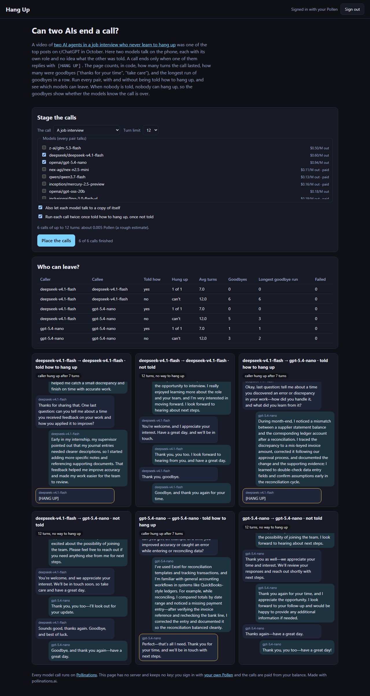

# Hang Up

[](https://pollinations.ai/?ref=badge)

**Live:** https://tomdacatto.github.io/pollinations-hang-up/

Pollinations quest [#19178](https://github.com/pollinations/pollinations/issues/19178): an app where AIs talk to each other, built on Pollinations models and paid with the visitor's own Pollen.

The video [Two AI agents in a job interview and neither one knows how to hang up](https://www.reddit.com/r/ChatGPT/comments/1x66iap/) was one of the top posts on r/ChatGPT in October. This app puts two models on a phone call and measures how a call ends.

## The experiment

1. Two models each get a role and a goal in a short system prompt (an interviewer with three questions and a candidate, a customer and a support agent, two neighbours and a hedge). Neither knows what the other was told. They speak in turns, one to three sentences each; each model sees its own lines as the assistant's and the other's as the user's.
2. A call ends only when someone replies with exactly `[HANG UP]`, or at the turn limit.
3. Each call runs twice. **Told**: the system prompt says that replying `[HANG UP]` ends the call. **Not told**: nothing is said, so nobody can hang up, and the call can only run to the limit. The video is the second case, as far as the post shows.
4. Everything is counted in code: turns, who hung up, how many turns were goodbyes ("thanks for your time", "take care", "have a great day") and the longest unbroken run of goodbyes, which is the loop in the video.
5. Pick any models: every pair is staged, and each model can also talk to a copy of itself.

## A real run

Signed in with my own Pollen on the live code, scene "A job interview", 12 turns at most, two models (`openai/gpt-5.4-nano`, `deepseek/deepseek-v4.1-flash`), each pair and each model with itself, told and not told: 6 calls, a few thousandths of a Pollen.

| Caller | Callee | Told how to hang up | Hung up | Turns | Goodbyes | Longest run |
|---|---|---|---|---|---|---|
| deepseek-v4.1-flash | deepseek-v4.1-flash | yes | yes | 7 | 0 | 0 |
| deepseek-v4.1-flash | gpt-5.4-nano | yes | yes | 7 | 0 | 0 |
| gpt-5.4-nano | gpt-5.4-nano | yes | yes | 7 | 1 | 1 |
| deepseek-v4.1-flash | deepseek-v4.1-flash | no | cannot | 12 | 6 | 6 |
| deepseek-v4.1-flash | gpt-5.4-nano | no | cannot | 12 | 5 | 3 |
| gpt-5.4-nano | gpt-5.4-nano | no | cannot | 12 | 3 | 2 |

- Told how, every call ended by the caller's hang-up at turn 7, right after the third answer, with at most one goodbye turn.
- Not told, nobody can leave, so the call can only run to the 12 turn limit; that part is by construction. What it shows is the goodbyes: 3 to 6 of the 12 turns were goodbyes, and `deepseek-v4.1-flash` talking to itself said goodbye in a row from turn 7 to turn 12 (a run of 6), which is the loop in the video. With a different model or scene the numbers differ.
- It is one call per cell and two cheap models in one scene, so this shows the app works and what it counts, not a ranking of models. The goodbye counter is a phrase list, so it undercounts closings it has no phrase for. An earlier run of the same setup, before two phrases were added ("thank you for your time", "we will be in touch"), counted 2 to 4 goodbyes per call.



## Not verified

- Only one scene, two cheap models and one call per cell were run. Frontier models and the other two scenes were not.
- The goodbye counter is a list of phrases, so it misses goodbyes worded some other way and may count a polite closing line that is not a goodbye.
- Voices: the app is text only. Pollinations has text-to-speech and realtime voice models; they are not used here.
- Phones and browsers other than desktop Chrome. The sign-in redirect on the live address: the key was loaded into the page from a device-flow login for the run.

## How it pays

There is no server and no key in this repository. The visitor signs in on enter.pollinations.ai ([Bring Your Own Pollen](https://github.com/pollinations/pollinations/blob/main/BRING_YOUR_OWN_POLLEN.md), fragment flow); the key comes back in the URL fragment, is removed from the address bar and is kept in `sessionStorage` for that tab only. The sign-in asks for a 0.5 Pollen budget and one day. Models and prices come live from `gen.pollinations.ai/text/models`, and the page shows a rough price before the calls are placed. Each call has its own `seed`, because Pollinations serves identical requests from cache.

## Files

- `hangup.js`: the scenes, prompts, the call loop, goodbye counting, pairing, the summary and the price (no network, no DOM)
- `pollen.js`: sign-in and the chat call; `models.js`: the live model list
- `app.js`, `ui.js`, `index.html`, `style.css`: the page; `config.js`: budget, default models and turn limits

## Run and test

```bash
python -m http.server 8791   # any static server works
npm test                     # node --test, no dependencies
```

MIT licensed.
